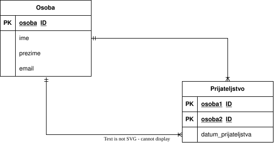

# Zadaća 1

**Hrvoje Kajba - G1**

## Unarna veza M:N

**Unarna veza M:N** je veza koja se pojavljuje kada u odnosu sudjeluje samo jedan entitet, odnosno kada se entitet povezuje sam sa sobom. Taj entitet u vezi ima dvije različite uloge, npr. _roditelj_ i _dijete_. U ovoj vezi entitet stvara odnos sam sa sobom (drugim riječima, tablica se spaja sama na sebe) umjesto da u vezi sudjeluje više tablice, odnosno entiteta.

Primjer unarne veze M:N bi bili prijatelji na socijalnim mrežama. Jedini entitet u tom slučaju je _osoba_. Svaka osoba može imati više prijatelja, te više osoba može imati tu osobu kao prijatelja.

Drugi primjer unarne veze M:N bi bili preduvjeti za neki kolegij. Kao i u prijašnjem primjeru, jedini entitet je _kolegij_ koji može imati više drugih kolegija kao svoj preduvjet, ali taj isti kolegij također može biti i preduvjet na više drugih kolegija.

Relacijski model inače ne podržava izravno unarnu M:N vezu, pa ju moramo razdvojiti na dvije unarne 1:M veze pomoću asocijativnog elementa. U ovom primjeru ću pokazati kako implementirati unarnu vezu M:N na primjeru prijateljstva na socijalnim mrežama.



U slici iznad je nacrtan ERA model unarne veze M:N na primjeru prijateljstva socijalnih mreža.

Prema ERA modelu znamo da ćemo imati dvije tablice:

```
Osoba(osoba_ID, ime, prezime, email)
Prijateljstvo(osoba1_ID, osoba2_ID, datum_prijateljstva)
```

Prema ovome možemo napisati SQL naredbe s kojima ćemo stvoriti taj relacijski model:

```sql
CREATE TABLE Osoba (
    osoba_ID INT PRIMARY KEY,
    ime VARCHAR(50) NOT NULL,
    prezime VARCHAR(50) NOT NULL,
    email VARCHAR(100) UNIQUE NOT NULL
);

CREATE TABLE Prijateljstvo (
    osoba1_ID INT NOT NULL,
    osoba2_ID INT NOT NULL,
    datum_prijateljstva DATE NOT NULL,
    PRIMARY KEY (osoba1_ID, osoba2_ID),
    FOREIGN KEY (osoba1_ID) REFERENCES Osoba(osoba_ID) ON DELETE CASCADE,
    FOREIGN KEY (osoba2_ID) REFERENCES Osoba(osoba_ID) ON DELETE CASCADE,
    CHECK (osoba1_ID < osoba2_ID)
);
```

Glavni entitet u ovome je `Osoba` dok je `Prijateljstvo` asocijativni entitet koji koristimo kao pomoć pri stvaranju veze. U asocijativnom entitetu `Prijateljstvo` stvaramo složeni primarni ključ koji se sastoji od dva vanjska ključa koja oboja referenciraju primarni ključ iz tablice `Osoba`. Komandu `CHECK` koristimo kako bi osigurali da se ne stvori par gdje su `osoba1_ID` i `osoba2_ID` isti.

## Usporedba unarne veze M:N sa unarnom vezom 1:M

U unarnoj vezi M:N znamo da imamo samo jedan entitet koji se spaja više puta sam sa sobom. U unarnoj vezi 1:M imamo hijerarhijski oblik. Postoje entiteti "roditelji" i "djeca". Entiteti "roditelji" su spojeni sa više entiteta "djeca". Entiteti "djeca" također mogu biti spojeni sa svojoj "poddijecom", tj. drugim entitetima "djeca", ali mogu imati samo jedan entitet "roditelj". Primjer ovoga bi bio hijerarhijski sustav u nekom poslovanju, gdje zaposlenik može imati više podređenih zaposlenika, ali samo jednog nadređenog.

## Usporedba unarne veze M:N sa unarnom vezom 1:1

U unarnoj vezi 1:1 svaka instanca entiteta povezana je s najviše jednom drugom instancom tog entiteta. Primjer ovoga bi bio bračni par. Entitet je `osoba` i ima vezu sa samo jednom drugom instancom tog entiteta koja je bračni drug tom prvom entitetu. Za razliku od toga entitet u unarnoj vezi M:N se može povezati sa više drugih instanca entiteta, te se više drugih instanca entiteta može povezati na taj entitet.
